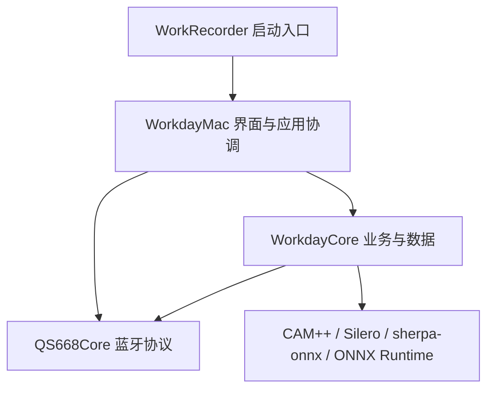

# 架构说明

工作留声由一个 Xcode App 和本地 Swift Package 组成。App 产品名为「工作留声」，仓库名为 `WorkRecorder`；Swift Package 与部分类型保留历史名称 `Workday`，避免为整理目录改动既有接口与数据标识。

## 模块依赖

- `QS668Core` 管理帧、命令、GATT 会话、按键应答与写入队列，不依赖应用界面。
- `WorkdayCore` 管理归档、音频处理、字幕连接、转写与整理流水线、时间线及声纹推理。
- `WorkdayMac` 按 App、Workspace、Captions、Device、Status、Playback、Voice、Settings 划分界面和协调责任。AppModel 协调共同状态，原生窗口与桌面气泡由有限的 AppKit 互操作承载。
- `WorkRecorder/MyApp.swift` 提供启动入口；Xcode 工程负责完整 App 的图标、权限、版本和许可资源。

## 主要数据流

| 输入 | 处理 | 结果 |
| --- | --- | --- |
| 录音卡 BLE 通知 | 拆帧、按键应答、状态解释、Opus 解码 | 录音状态、输入电平、实时字幕与回听缓存 |
| 实时音频 | Apple 本机识别、可选云端选路或定稿后复核 | 同一字幕身份持续修订，历史与桌面气泡同步 |
| USB 原件 / 本地音频 | 复制、大小和 SHA-256 核验、登记归档 | 本地完整录音；通过核验后按设置清理卡内副本 |
| 已归档录音 | 分段转写、对话整理、剪辑、全天归类 | 可恢复的处理进度、事项、原话和摘要 |
| 本人反馈 / 手动命名 | 选取对应语音、提取向量、确认与更正 | 本地声纹样本与具名发言人匹配 |

实时字幕缓存与 USB 完整原件是两条路径。字幕不能补回蓝牙完全未收到的音频；云端发言人编号也不等于跨录音的本地声纹身份。

## 资料库和兼容

默认根目录为 `~/Documents/工作留声/`，可在设置中切换。`Records/` 保存原件、转写及剪辑，`Days/` 保存全天结果，`Sync/` 保存同步、字幕与声纹等状态。API Key 独立存入 macOS 钥匙串。

数据对象带版本或兼容解码逻辑，处理流水线保留可恢复进度。修改存储结构前必须考虑旧资料、失败重试、人工事项归属与确认声纹，不能用重建资料库代替迁移。App bundle ID 和钥匙串服务名承载历史兼容关系，不随目录或仓库名称修改。

## 验证层次

普通 SwiftPM 测试覆盖协议与业务逻辑，不需要真实账号。完整验收通过环境变量启用外部音频、系统语音模型和后台窗口检查。实体硬件、真实云端请求、长期录音与识别准确率需要独立验证。

准确命令与目录见[开发指南](开发指南.md)，当前记录见[项目基线](项目基线.md)，数据出站范围见[隐私与数据](隐私与数据.md)。
